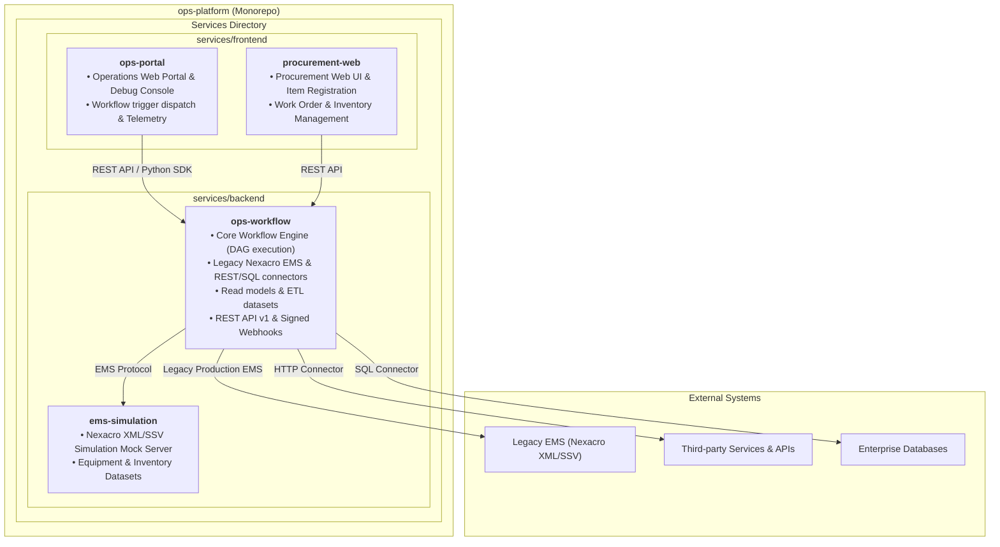

# ops-platform — Enterprise Operations Management Platform Monorepo

> **Operations Management Platform (`ops-platform`)**: A comprehensive enterprise platform orchestrating operations automation, legacy enterprise integration (Nexacro EMS), operational workflows, and interactive administrative web portals.

---

## 🏛️ Platform Architecture & Services

The platform is organized as a unified monorepo cleanly separated into **Backend Services** and **Frontend Applications**:



---

## 📂 Repository Layout

```
ops-platform/
├── README.md                                  # Platform overview & documentation
├── docker-compose.yml                         # Local orchestration for platform services
├── .env.example                               # Global environment configuration template
├── start.sh                                   # Multi-service local dev startup script
├── .github/
│   └── workflows/ci.yml                       # Continuous Integration workflow
└── services/
    ├── backend/
    │   ├── ops-workflow/                      # Component 1: Core Workflow Engine & Connectors
    │   └── ems-simulation/                    # Component 2: Nexacro EMS Simulation Mock Server
    └── frontend/
        ├── ops-portal/                        # Component 3: Operations Portal & DAG Visualizer
        └── procurement-web/                   # Component 4: Procurement Management Web Interface
```

---

## 🚀 Component Summary

| Directory | Component | Technology | Role |
|---|---|---|---|
| [`services/backend/ops-workflow/`](services/backend/ops-workflow/) | **Core Engine** | Python ≥ 3.11, FastAPI, SQLAlchemy, APScheduler | Core automation backbone, EMS connector, data pipeline & API |
| [`services/backend/ems-simulation/`](services/backend/ems-simulation/) | **EMS Simulator** | Python ≥ 3.11, FastAPI, Uvicorn | Nexacro XML/SSV protocol mock server & test dataset catalog |
| [`services/frontend/ops-portal/`](services/frontend/ops-portal/) | **Operations Portal** | React 18, Vite, Tailwind CSS, Lucide | Operator UI, DAG debug console, workflow runner & DB explorer |
| [`services/frontend/procurement-web/`](services/frontend/procurement-web/) | **Procurement Web** | React 18, Vite, Tailwind CSS | Requisition portal, LEC workbench, and budget/cost views |

---

## 🚀 Khởi động Nhanh Khi Đưa Vào Máy Mới (Quickstart for New Machines)

Dự án cung cấp bộ script tự động hóa hoàn chỉnh cho cả Windows và Linux/macOS. Chỉ cần 1 thao tác duy nhất để thiết lập và chạy toàn bộ 4 dịch vụ:

### 1. Dành cho Windows (Khuyến nghị)

#### Bước 1: Cài đặt tự động toàn bộ môi trường (Setup)
Nhấp đúp chuột vào file **`setup.bat`** (hoặc mở PowerShell chạy `.\setup.ps1`):
* Tự động kiểm tra Python 3.11/3.12 và Node.js 18+.
* Tự động khởi tạo file cấu hình `.env` từ `.env.example`.
* Tự động tạo virtualenv và cài đặt dependencies cho 2 backend (`ems-simulation`, `ops-workflow`).
* Tự động cài đặt npm packages cho 2 frontend (`ops-portal`, `procurement-web`).

```powershell
# Hoặc chạy qua PowerShell:
.\setup.ps1
```

#### Bước 2: Khởi động toàn bộ 4 dịch vụ (Run)
Nhấp đúp chuột vào file **`start.bat`** (hoặc mở PowerShell chạy `.\start.ps1`):
* Tự động kiểm tra giải phóng cổng xung đột (9000, 8000, 5174, 5173).
* Khởi chạy song song cả 4 dịch vụ trong nền.
* Tự động kiểm tra trạng thái sức khỏe (Health Check).
* Tự động mở trình duyệt Web Portal.
* Nhấn `Ctrl + C` để dừng đồng thời và sạch sẽ toàn bộ 4 dịch vụ.

```powershell
# Hoặc chạy qua PowerShell:
.\start.ps1
```

---

### 2. Dành cho Linux / macOS / WSL

```bash
# Bước 1: Thiết lập môi trường tự động
chmod +x setup.sh start.sh
./setup.sh

# Bước 2: Khởi chạy toàn bộ hệ thống
./start.sh
```

---

### 3. Khởi động bằng Docker Compose (Tùy chọn)

```bash
# Build và chạy toàn bộ qua Docker Compose:
docker compose up --build

# Hoặc dùng script tiện ích:
.\start.ps1 -Docker      # Trên Windows
./start.sh --docker      # Trên Linux/macOS
```

---

## 🌐 Danh sách Cổng & Địa chỉ Dịch vụ

| Dịch vụ | Loại | Cổng mặc định | URL Truy cập |
|---|---|---|---|
| **Opsflow Portal Console** | Frontend UI | `5174` | [http://localhost:5174](http://localhost:5174) |
| **Procurement Web UI** | Frontend UI | `5173` | [http://localhost:5173](http://localhost:5173) |
| **Opsflow Core Engine API** | Backend API | `8000` | [http://localhost:8000](http://localhost:8000) (Docs: `/api/v1/docs`) |
| **EMS Simulation Mock Server**| Backend Sim | `9000` | [http://localhost:9000](http://localhost:9000) (Health: `/health`) |

---

## 💻 Getting Started with Docker Compose

Spin up all platform services locally:

```bash
# Build and start all active platform services
docker compose up -d

# Check logs
docker compose logs -f ops-workflow

# Access Core API
curl http://localhost:8000/health

# Access Web Interfaces:
# - Ops Portal:         http://localhost:5174
# - Procurement Web:    http://localhost:5173
# - EMS Simulator:      http://localhost:9000
```
