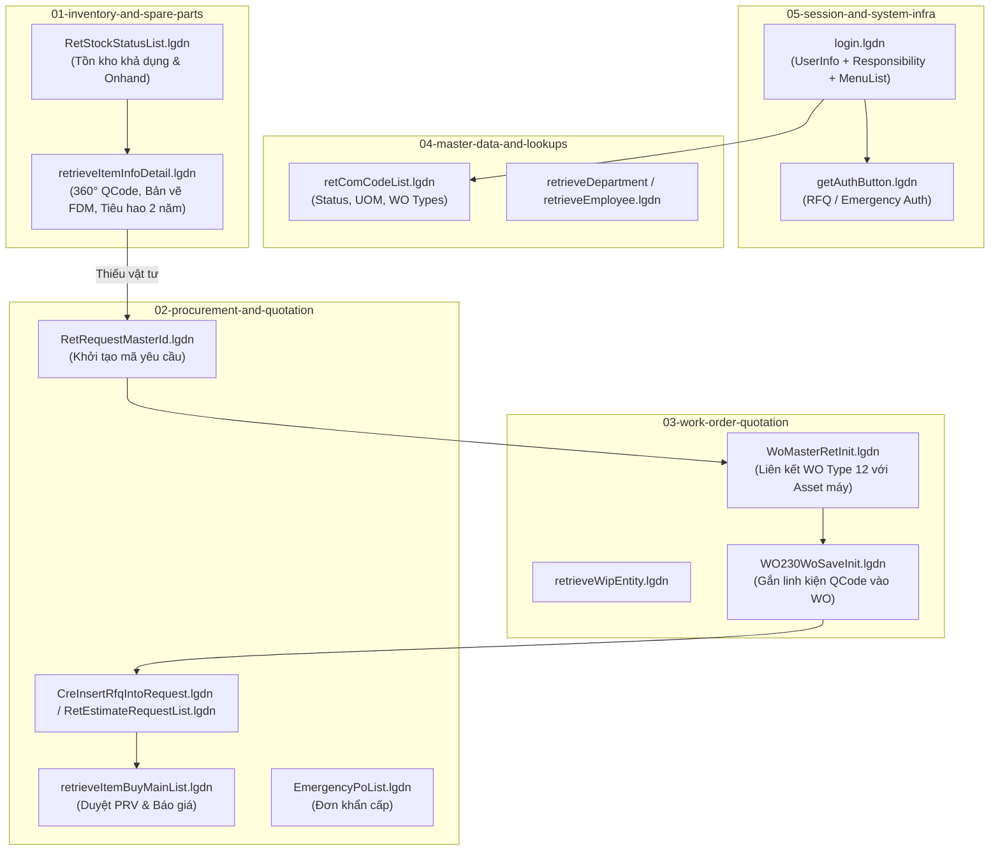

# API Catalog Index — Nexacro EMS API Specifications

Tài liệu này tổng hợp và phân loại toàn bộ **31 Nexacro API endpoints** (166 lượt gọi) được ghi nhận trong tệp trace `nexacro_api_...yaml`.

---

## 📂 Danh mục Phân loại Thư mục

| Thư mục | Tên phân hệ | Số lượng API | Vai trò chính |
|---|---|:---:|---|
| [`01-inventory-and-spare-parts/`](./01-inventory-and-spare-parts/) | **Quản lý Kho & Vật tư** | 4 APIs | Tra cứu tồn kho, định mức an toàn, tiêu hao lịch sử và hồ sơ QCode linh kiện |
| [`02-procurement-and-quotation/`](./02-procurement-and-quotation/) | **Mua sắm & Báo giá (RFQ)** | 7 APIs | Sinh mã PRV, gửi báo giá (RFQ), đơn mua khẩn cấp (Emergency PO), luân chuyển vật tư |
| [`03-work-order-quotation/`](./03-work-order-quotation/) | **Work Order phục vụ Báo giá** | 4 APIs | Quản lý WO Type 12 (PR / Pre-RFQ Work Order) liên kết máy với linh kiện cần báo giá |
| [`04-master-data-and-lookups/`](./04-master-data-and-lookups/) | **Danh mục Dùng chung & Popup** | 4 APIs | Common codes (18 loại), popup nhân viên, phòng ban phụ trách ngân sách |
| [`05-session-and-system-infra/`](./05-session-and-system-infra/) | **Hạ tầng Nexacro & Logging** | 12 APIs | Đăng nhập phiên, cấp quyền Menu (173 màn hình), lưu Grid Format và đo đạc log |

---

## 🗺️ Bản đồ Tương tác Nghiệp vụ giữa các Nhóm API

